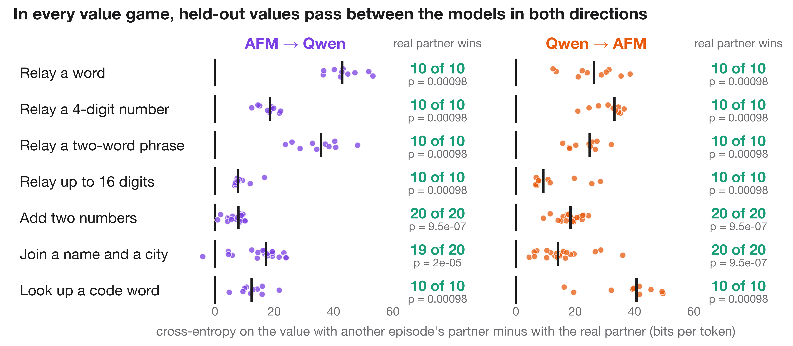
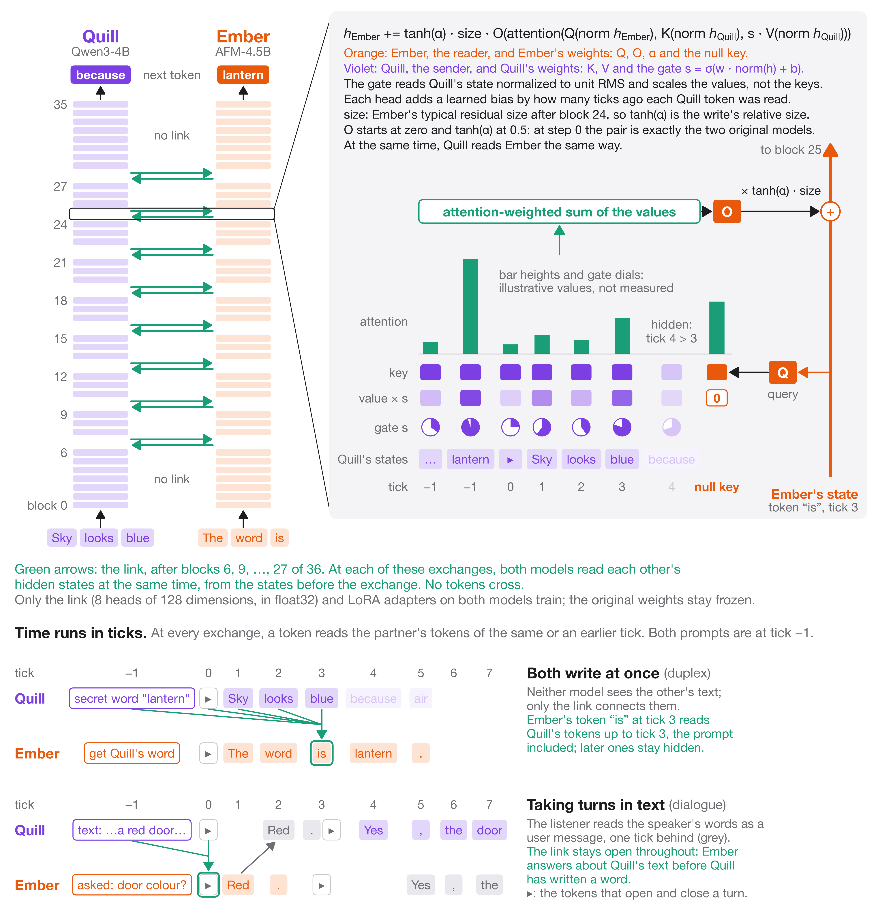
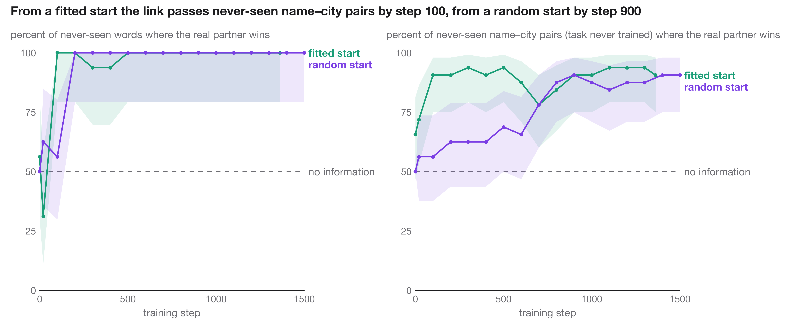

# neural-pairing

Two language models from different families, Quill (Qwen3-4B) and Ember (AFM-4.5B), are joined by a learned link
between their hidden states. At 8 depths, each model reads the other's hidden states through gated cross-attention, in
both directions, inside one joint forward pass. No tokens cross the link. Each model still writes ordinary text, and in
dialogue games each reads the other's words as a user message, as in a normal chat.

**Result.** After a warm-up on seven value games, the link passes held-out words, 4-digit numbers, two-word phrases,
digit strings, sums, name–city pairs and code-word lookups in both directions. After 900 warm-up steps, the
receiver's cross-entropy on the value is lower with its real partner than with the partner of another episode in 179 of
180 held-out episodes, and every game passes in both directions at p < 0.05 (figure). No held-out value is ever used as
a value in training: words, phrases, names, cities and code words come from disjoint pools, sums are 50–99 (training
0–49), and numbers and digit strings have a digit sum of 3 modulo 7 (training: any other). With the full
training mix the models also read each other's texts through the link: in shared-reading games, the reader's mean
cross-entropy on the answer over held-out episodes is lower with its real partner than with a shuffled one in 31 of 32
game–receiver groups (16 games, step 600).



## The link



After blocks 6, 9, …, 27 of 36, each model x reads the other model y:

    h_x += tanh(α) · size · O(attention(Q(norm h_x), [null; K(norm h_y)], [0; s · V(norm h_y)]))

- Q, O and α belong to the reader; K, V and the visibility gate s = σ(w · norm(h_y) + b) belong to the sender. The gate
  is one number per sender position and exchange, and it scales the values, so a closed gate hides the position.
- size is the reader's typical residual size after that block, so tanh(α) is the write's size relative to the
  residual stream. A learned null key with a zero value lets a reader attend to nothing.
- Time runs in ticks: a token reads the partner's tokens of the same or an earlier tick, and both prompts sit at tick −1.
  Each head has a learned bias by how many ticks ago a partner token was read.
- Both reads at an exchange use the states before the exchange, so the dependency graph is acyclic in depth and the
  joint teacher-forced pass equals tick-by-tick generation.
- 8 heads of 128 dimensions in float32 per exchange and direction. The link and rank-32 LoRA adapters on both models
  train; the original weights are frozen.

## Starting from a fitted map (`align.py`, `train.py --content_init qkvo`)

A link with random Q and K attends to arbitrary partner positions, so its first gradients are weak and inconsistent.
The fitted start sets every exchange so that a reader position attends to the partner position that has read the same
text:

1. Both models read the same 192 texts (none from the held-out split). A token of one model and a token of the other
   match when both end at the same character.
2. At each exchange, a ridge regression maps the sender's normalized states to the reader's (M, about 4,300 matched
   token pairs; the penalty is chosen on texts outside the fit).
3. The sender's keys become K = c · Q · M, so a query's logit on a key is its similarity to the reader state predicted
   from that key. V and O start from the top singular directions of M, so a write delivers the matched partner state
   mapped into the reader's space.

On the 6 texts outside the fit, the reader's top attention lands on the matched partner token 89–97% of the time
(chance 1.2%; 1% with random Q and K); R² of the map is 0.51–0.66. tanh(α) starts at 0.1, so at step 0 each write is
a small mapped copy of the matched partner state (about 5% of the residual's size). A random start also opens the
link when training starts with the value games only, more slowly and with less transfer to games it was not trained
on (name–city pairs 20/32 vs 29/32 at step 200); in the full mix from a random start, the gates closed before the link
opened.



## Games and turn structures

**Value games** put a value in one model's prompt that the other model must write: relay a word, a 4-digit number, a
two-word phrase or up to 16 digits; add two numbers, one in each prompt; join a name and a city, one in each prompt;
look up a code in the partner's table.

**Shared reading** (`coread.py`): a text or task is split between the models (a question on one side and the
passage on the other, a premise and a hypothesis, a word problem, code and a question about its output, a multiple-
choice question and its options, a text to translate or paraphrase), and the reader answers. With distillation
(`prep_coread.py`), the reader's whole reply is trained toward the reply the original model writes when it reads the
whole text itself.

**Play** (`co_play`, written by `prep_talk.py --play`): six-turn conversations in which each model holds a secret: guess
my word, the gift you wish for, where I am on holiday, a shared story on your topic, a rhyme on your word. The opener
names the partner's secret in its first turn and the partner names the opener's in its reply. The models wrote these
conversations themselves, each naming turn with the partner's secret shown; in training the secret is gone from the
prompt, so it can only come through the link. Conversations in which the opener says its own secret are dropped.

**Turn structures** (`session.py`):

- duplex: both models write at once, one token per tick, and neither sees the other's text;
- dialogue: alternating turns; the listener reads the speaker's words as they are written, and reads its hidden
  states through the link;
- silent rounds (`--pause K`): K ticks before each reply or turn in which both models write only a space, so only
  hidden states pass;
- shared pen (`--pen P`): the two models write one text together, alternating words.

## Evaluation

Every value in an evaluation episode comes from the held-out split: it is never used as a value in training (it can
still appear as an ordinary word in training texts). Words, phrases, names, cities and code words come from disjoint
pools; sums are 50–99 in evaluation and 0–49 in training; numbers and digit strings whose digit sum is 3 modulo 7 are
held out (from 673d582; earlier runs drew training numbers from the full range). Each game has 16 episodes at every
evaluation step (`train.py --payload_eval`) and 20 on the final checkpoint (`payload_ctl.py`), half with each model as
the receiver.

- **Shuffle control.** Each episode is also run with the partner of another episode of the same game, in the same
  roles. The receiver's input is perturbed as much as with the real partner, but the value is gone. The readout is the
  cross-entropy on the value tokens with the shuffled partner minus with the real partner, per episode.
- **Test.** The count of episodes in which the real partner wins, with an exact one-sided sign test. Ties (a link that
  writes exactly nothing) are left out. The size of the gap is not the readout: a confident wrong copy from the
  shuffled partner inflates it.
- The link-cut control (no partner at all) is also recorded; it changes the receiver's input more than a shuffle does.
- In free generation of dialogues, a shuffled partner is not an isolated control: the generated text carries
  information from episode to episode around the shuffle, so free-generation comparisons are with the link cut.

**Other measurements:** `turnbench.py` scores the same secrets under every turn structure; `lens.py` shows, per token,
how much the link changed the reader's next-token distribution, which partner tick it came from (tick ablations) and
what each exchange's write decodes to downstream; `play_live.py` plays a game on the Mac from a trained checkpoint
(4-bit MLX) and saves it as a web page with each token shaded by the size of the link's write.

## Training (`train.py`)

The link and the LoRA adapters train together. A run starts with the value games only (`--relay_first`, all seven
games), then trains on the full mix of value games, shared reading, play, dialogue and identity anchors, with the gates
and α frozen (`--hold`). `--micro K` splits each batch into K groups of similar length with summed gradients, so short
value episodes are not padded to the length of play conversations: on one A100 80 GB, 4.5 s per step for the full mix
instead of 8.

## Earlier designs

1. **Additive residual write.** A send head wrote a 256-number message and a gate into the partner's residual stream
   after block 11. The value was decodable from the message (128/128 episodes, chance 2%), but the receiver never
   learned to use it, and the gates closed once sending had a cost.
2. **Soft-token slot.** Each message became an extra input position. The only slice that passed information was the
   sender's next-token distribution re-embedded as text (adding two numbers, Qwen to AFM); the learned part passed
   nothing. Per-slice results are in `results/probe.json`.

## Exactness checks (`tests/`)

On tiny random models of both architectures (CPU, float32):

| Check | Max difference |
|---|---|
| Joint teacher-forced pass vs tick-by-tick generation (last hidden state, relative; duplex, dialogue, shuffled partners, link closed after turn 1) | 4.9e-7 to 5.8e-7 |
| Gradients with vs without gradient checkpointing | 0 |
| Gradients of one batch vs length-grouped micro-batches vs two ranks | 2.2e-7 |
| Logits with untrained links (α = 0) vs the plain models | 0 (bit for bit) |
| Recorded attention (explicit softmax) vs fused attention | 1.6e-6 |

## Running

```
pip install torch transformers peft datasets safetensors scipy matplotlib
cd pairing
python prep.py --out OUT                                         # prompts and teacher-forced replies
python build_coread.py                                           # public texts both models read -> data/coread.json
python prep_talk.py --play --turns 6 --n_train 1600 --n_test 300  # play conversations -> data/play.json
python prep_coread.py --replies OUT/replies.json                 # distillation replies, added to replies.json
python train.py --replies OUT/replies.json --out OUT/run --content_init qkvo --read_start 0.1 --gate_norm --hold 100000 \
    --payload_w 3 --relay_first 900 --relay_games relay_word,relay_number,relay_phrase,relay_digits,merge_sum,merge_fact,lookup \
    --steps 3000 --coread 0.35 --dialogue 0.15 --anchor 0.1 --pen 0.05 --pause 4 --pause_p 0.5 --comp 0 --micro 4 \
    --ckpt none --payload_eval 16
python payload_ctl.py --run OUT/run/step_N --replies OUT/replies.json --out OUT/payload.json --n 20 --coread
python turnbench.py --run OUT/run/step_N --replies OUT/replies.json --out OUT/turnbench.json --n 128
cd .. && python tests/test_link.py && python tests/test_align.py && python tests/test_coldstart.py
python figures/make_figures.py transfer=OUT/payload.json opened=OUT/run
```

---

Claude Opus 5.5
