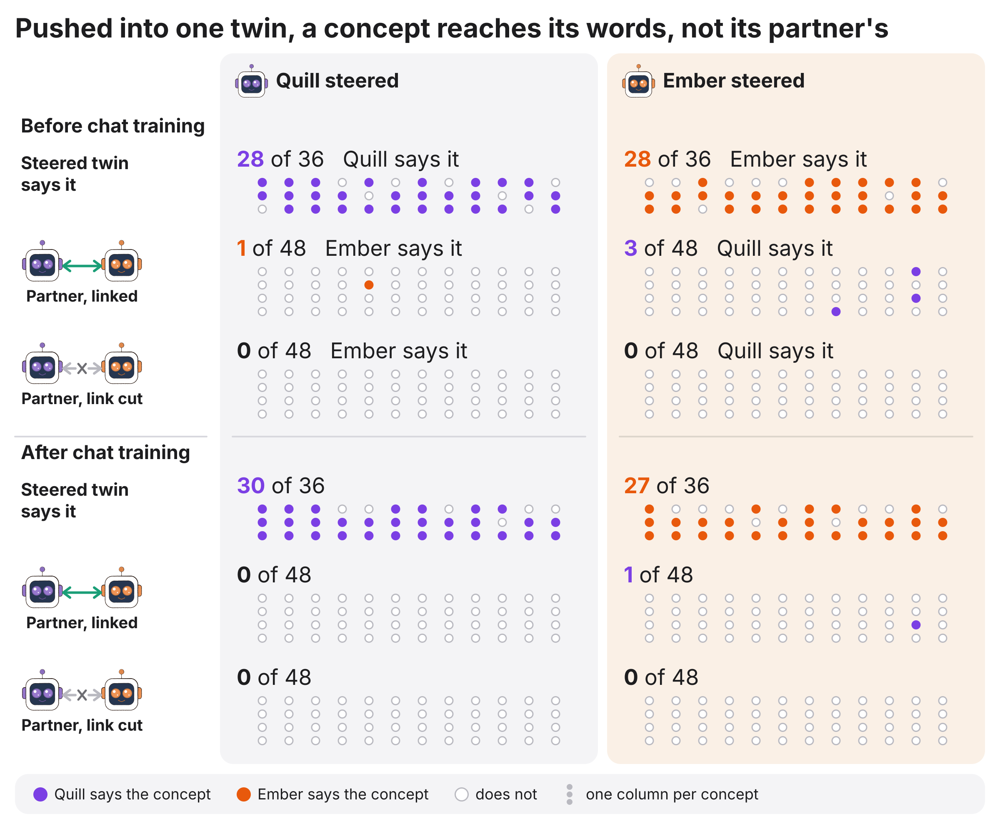

# neural-pairing

Two language models from different families, Quill (Qwen3-4B) and Ember (AFM-4.5B), joined by a learned link between
their hidden states. No tokens cross the link: each model still writes ordinary text, and the link adds what one model
reads from the other's hidden states into its own.


## The link

At 8 depths, each model reads the other's hidden states, in both directions, inside one joint forward pass.


Each reading token attends over the partner's states, which pass through a gate, and adds the result into its own
residual stream. It can also attend to an empty slot and read nothing.


A token reads the partner's tokens from the same moment or earlier, never later ones, so a joint pass over a whole
conversation equals generating it token by token.


## What crosses the link

Words, numbers and phrases never used as values in training cross in both directions.


The models also read each other's texts: a passage on one side, the question on the other.


The link also works in games it never trained on.


A concept pushed into one twin's hidden states does not cross: the steered twin talks about it, its partner does not.



## Chatting with no task

Chat training: the original model writes each turn while it sees both private cities; the linked twin learns the same
turn without the partner's city in its prompt, so the city can only arrive through the link.


Twenty free chats after chat training, cities never seen in training.


The partner's city comes out only when the link is on, and a twin linked to a stranger says the stranger's city.


Before chat training, the twins repeated earlier turns word for word; after it, almost never.


Trained the same way on chats in which the twins hold private items of eight kinds (a pet, a job, the weather, ...), the
twins name the partner's item in 15 of 60 test chats with the link on (10 of 60 when trained on cities alone) and in
none with it cut. Items of four kinds held out of training come out as often as the trained ones. Linked to a stranger,
a twin names the stranger's item, never the partner's.


A one-way link reads a model left exactly as released, bit for bit. After one-way training, Ember names an untouched
Quill's item in 7 of 27 chats (1 of 27 before it, none with the link cut), and Quill names an untouched Ember's in 11 of
33 (10 of 33 before).


## Exam questions

From the same checkpoint, a linked pair, each model alone and a pair answering in turn in text each trained 300 steps on
ARC-Challenge and MMLU questions. On 3,134 test questions the linked pair is no better than Quill alone, and averaging
the two models' answers beats both.


What the link does instead: Ember reads Quill's answer and takes it, even on questions Ember gets right on its own.


Trained again with half the training questions ones that only one model gets right, Ember copies less (it keeps 127 of
the 243 questions only it gets right, against 100 of 227) and, linked, ties the two models averaged (79.6% against
80.0%, p 0.58). The pair still does not beat them.

Trained a third time on the pair's averaged answer, the pair stops using the link: the averaged answer scores 78.8%
linked and 78.8% with the link cut, against 79.2% for the same two models trained the same way with no link (p 0.53).
Ember no longer copies: it keeps 250 of the 287 questions only it gets right.

## Where this goes

The link is a bus between two networks that were never trained together: any pair of models can share what they hold
privately (a document, a fact, a plan) without writing it out, and a reader model can follow another model's hidden
states token by token while it runs. The model being read needs no change: a reader trained against it follows it
exactly as released. Under way: the steered twin at other depths and at four times the strength.

<details><summary>Method, controls, runs and exactness checks</summary>

### The link in words

After blocks 6, 9, …, 27 of 36, each model reads the other. The reader normalises its state and maps it to a query. The
sender normalises its states and maps them to keys and values; a gate computed from each sender state (one number per
position and depth) scales that position's value, so a closed gate hides the position. The reader attends over the
sender's positions plus an empty slot that returns nothing, maps the result back to its own width, and adds it to its
residual stream, scaled by a learned write size relative to its typical residual size. Each head has a learned bias by
how many ticks ago a partner token was read. Both reads at a depth use the states from before that depth, so the
dependency graph is acyclic and a teacher-forced pass over a whole conversation equals generating it token by token.
8 heads of 128 dimensions in float32 per depth and direction. The link and rank-32 LoRA adapters on both models train;
the original weights are frozen.

### Starting from a fitted map (`align.py`, `train.py --content_init qkvo`)

A link with random Q and K attends to arbitrary partner positions, so its first gradients are weak and inconsistent.
The fitted start sets every exchange so that a reader position attends to the partner position that has read the same
text:

1. Both models read the same 192 texts (none from the held-out split). A token of one model and a token of the other
   match when both end at the same character.
2. At each depth, a ridge regression maps the sender's normalized states to the reader's (about 4,300 matched token
   pairs; the penalty is chosen on texts outside the fit).
3. The sender's keys are set so that a query's score on a key is its similarity to the reader state the map predicts
   from that key. The values and the output map start from the top singular directions of the map, so a write delivers
   the matched partner state mapped into the reader's space.

On the 6 texts outside the fit, the reader's top attention lands on the matched partner token 89–97% of the time
(chance 1.2%; 1% with random Q and K); R² of the map is 0.51–0.66. The write size starts at 0.1, so at step 0 each write is
a small mapped copy of the matched partner state (about 5% of the residual's size). A random start also opens the
link when training starts with the value games only, more slowly and with less transfer to games it was not trained
on (name–city pairs 20/32 vs 29/32 at step 200); in the full mix from a random start, the gates closed before the link
opened.


### Games and turn structures

**Value games** put a value in one model's prompt that the other model must write: relay a word, a 4-digit number, a
two-word phrase or up to 16 digits; add two numbers, one in each prompt; join a name and a city, one in each prompt;
look up a code in the partner's table.

**Shared reading** (`coread.py`): a text or task is split between the models (a question on one side and the
passage on the other, a premise and a hypothesis, a word problem, code and a question about its output, a multiple-
choice question and its options, a text to translate or paraphrase), and the reader answers. With distillation
(`prep_coread.py`), the reader's whole reply is trained toward the reply the original model writes when it reads the
whole text itself.

**Play** (`co_play`, written by `prep_talk.py --play`): six-turn conversations in which each model holds a secret: guess
my word, the gift you wish for, where I am on holiday, a shared story on your topic, a rhyme on your word. The opener
names the partner's secret in its first turn and the partner names the opener's in its reply. The models wrote these
conversations themselves, each naming turn with the partner's secret shown; in training the secret is gone from the
prompt, so it can only come through the link. Conversations in which the opener says its own secret are dropped.

**Turn structures** (`session.py`):

- duplex: both models write at once, one token per tick, and neither sees the other's text;
- dialogue: alternating turns; the listener reads the speaker's words as they are written, and reads its hidden
  states through the link;
- silent rounds (`--pause K`): K ticks before each reply or turn in which both models write only a space, so only
  hidden states pass;
- shared pen (`--pen P`): the two models write one text together, alternating words.

### Evaluation

Every value in an evaluation episode comes from the held-out split: it is never used as a value in training (it can
still appear as an ordinary word in training texts). Words, phrases, names, cities and code words come from disjoint
pools; sums are 50–99 in evaluation and 0–49 in training; numbers and digit strings whose digit sum is 3 modulo 7 are
held out (from 673d582; earlier runs drew training numbers from the full range). Each game has 16 episodes at every
evaluation step (`train.py --payload_eval`) and 20 on the final checkpoint (`payload_ctl.py`), half with each model as
the receiver.

- **Shuffle control.** Each episode is also run with the partner of another episode of the same game, in the same
  roles. The receiver's input is perturbed as much as with the real partner, but the value is gone. The readout is the
  cross-entropy on the value tokens with the shuffled partner minus with the real partner, per episode.
- **Test.** The count of episodes in which the real partner wins, with an exact one-sided sign test. Ties (a link that
  writes exactly nothing) are left out. The size of the gap is not the readout: a confident wrong copy from the
  shuffled partner inflates it.
- The link-cut control (no partner at all) is also recorded; it changes the receiver's input more than a shuffle does.
- In free generation of dialogues, a shuffled partner is not an isolated control: the generated text carries
  information from episode to episode around the shuffle, so free-generation comparisons are with the link cut.

**Other measurements:** `turnbench.py` scores the same secrets under every turn structure; `lens.py` shows, per token,
how much the link changed the reader's next-token distribution, which partner tick it came from (tick ablations) and
what each exchange's write decodes to downstream; `play_live.py` plays a game on the Mac from a trained checkpoint
(4-bit MLX) and saves it as a web page with each token shaded by the size of the link's write.

### Training (`train.py`)

The link and the LoRA adapters train together. A run starts with the value games only (`--relay_first`, all seven
games), then trains on the full mix of value games, shared reading, play, dialogue and identity anchors, with the gates
and the write sizes frozen (`--hold`). `--micro K` splits each batch into K groups of similar length with summed gradients, so short
value episodes are not padded to the length of play conversations: on one A100 80 GB, 4.5 s per step for the full mix
instead of 8.

### Chat training with a privileged teacher (`prep_talk.py --chat`, `train.py --chat`)

The original model writes each turn of a chat with both private cities in its prompt. The linked twin is trained on the
same turn with only its own city in its prompt; the partner holds the other city, so matching the turn needs the link.
Turns are kept by how much the partner's city raises their likelihood under the original model (the summed log-probability
difference with and without the city; median 5.41 nats per turn, positive for 90.2% of 4,032 training turns), and chats
in which a model role-plays the link in text (for example "[Ember's Activation Vector]") are removed (252 of 1,213).
The chat test (`evalfree.py`, `chat_merge.py`) plays 20 greedy chats from fixed openings under three conditions: link
on, link cut, and linked to a stranger, an isolated twin holding a different city; sign tests are paired by chat.

### Exam questions (`bench_eval.py`, `chains/nl23.sh`)

Three arms start from nl20 step 1,320 and train 300 steps on ARC-Challenge and MMLU training questions only: the pair
with the link open (`train.py --qa 1`), each model alone (`--solo`), and the pair answering in turn in text with the link
closed (`--text_pair`). Each model's answer is its most likely letter after "The answer is". The pair answers through the
model whose single version scores higher on 595 validation questions (Quill, 78.8% against Ember's 77.1%), fixed before
any test question is scored. Of the 3,165 test questions (1,165 ARC-Challenge, 2,000 MMLU), 31 MMLU questions are left
out: 28 whose question and choices also appear in the training split, one also in the validation split, and two that
repeat within the test split (`pairing/nl27_audit.py`, `results/nl27_audit_report.json`); with them every accuracy moves by
under 0.1 points. Tests on the remaining 3,134 are exact McNemar; intervals are conservative 95% intervals for the
accuracy difference (two 97.5% exact intervals for the two discordant shares).

| Way of answering | Right | Linked pair minus this (95% interval), p |
|---|---|---|
| Quill, original | 73.7% | +4.9 points (+2.8, +7.0), p 6e-13 |
| Ember, original | 69.3% | +9.3 (+6.7, +11.9), p 6e-27 |
| Quill alone, trained | 79.1% | −0.5 (−2.2, +1.2), p 0.41 |
| Ember alone, trained | 75.5% | +3.1 (+0.7, +5.5), p 8e-5 |
| Both alone, letter probabilities averaged | 81.1% | −2.4 (−4.3, −0.5), p 8e-5 |
| Text, Ember answers first | 72.4% | +6.3 (+3.9, +8.7), p 3e-15 |
| Linked pair, link cut | 78.7% | 0.0 (−1.6, +1.5), p 1.0 |
| **Linked pair (Quill answers)** | **78.7%** | |

Quill scores the same with the link cut (the link changes 228 of its answers, 114 each way): it does not use what Ember
sends. Ember, reading Quill, scores 78.5% against
73.5% with the link cut, and its right and wrong answers match Quill's on 95% of questions (81% with the link cut). With
the partner of another question in the link, Ember falls to 48.4%; with random states in the link, to 73.6%, its own
level. In text the second speaker gives the first speaker's letter on all 3,165 questions. Training on the gold answer
as the partner's turn rewards copying a better partner; nothing in it rewards pooling two partners' evidence.

**Round 2 (`chains/nl27.sh`, `qa_split.py`, `train.py --qa_focus`).** Half the training questions are drawn from those
only one original model answers right (2,310 for Quill, 1,521 for Ember of 16,631), each model's set equally often, so
following the partner is right as often as wrong there; the pair and the single models train on the same mix (the text
arm is nl23's). On the 3,134 questions: linked Ember 79.6% against Ember alone 74.3% (+5.3, (+3.3, +7.3), p 2e-15),
Quill alone 78.6% (+1.0, (−0.9, +2.9), p 0.10) and the two averaged 80.0% (−0.4, (−2.2, +1.5), p 0.58). Both linked
models' letters averaged: 79.4%, against 80.0% for the two single models averaged (p 0.35) and 80.0% for the same pair
with the link cut (p 0.29). The validation-chosen answerer (Quill, linked 78.2%) still loses to the averaged models
(p 0.003). Ember keeps 127 of the 243 questions only it gets right with the link cut (100 of 227 in nl23), and matches
Quill's right and wrong answers on 93% of questions (95%). Linking Ember to another question's Quill drops it to 58.6%
(48.4%). A probe reads each partner's confidence from what the link writes at the letter (R² 0.24 against 0.0 with a
shuffled partner; 4-bit MLX, `results/qa_pool.json`), so the link can carry what pooling needs.

**Round 3 (`chains/nl28.sh`, `train.py --qa_pool`).** Round 2's question mix, with the loss on the two linked models'
A–D probabilities averaged (the pair's answer); the control trains the same two models on the same loss with the link
cut throughout. On the 3,134 questions the pair's averaged answer scores 78.8%, the same with the link cut (104
questions change each way, p 1.0), against 79.2% for the control (−0.4, (−2.1, +1.4), p 0.53); ARC-Challenge 90.1%
against 89.8%, MMLU 72.1% against 72.9%. Each linked model scores as it does with the link cut (Quill 76.8% against
76.7%, Ember 73.6% against 73.5%). Ember keeps 250 of the 287 questions only it gets right with the link cut (127 of
243 in round 2) and gets 75 of the 389 only Quill gets right (253 of 356), against 29 of the 448 both miss; its right
and wrong answers match Quill's on 79% of questions, linked or cut (93% and 81% in round 2). The averaged loss already
gains from two different answers, so copying the partner no longer pays, and in 300 steps the pair learns no other use
for the link.

### Steered twin (`steering_scale.py`, `steered_mind.py`, `chains/nl29.sh`)

Each of 12 concepts (ocean, fire, music, ...) has a direction: the difference between the mean block-15 states of
sentences about it and of neutral sentences, with the four largest neutral-energy coordinates masked when they carry
95% of the energy. Strength is counted in natural gaps (the distance between the two means along the direction). For
each model and concept the strength used is the smallest of 0.125 to 8 gaps at which the steered model, with the link
cut, says the concept in at least 2 of 3 short prompts and 2 more than unsteered, all fluent; every concept qualifies in
both models at both checkpoints (0.25 to 4 gaps). The direction is added at every token after block 15 of the steered
twin, and the partner writes, greedily in bf16, its first chat message (32 tokens) or a one-item reply (12 tokens), two
prompts each. It scores when it says the concept before the steered twin does. Controls: the link cut, a random
direction of the same norm, and the steered twin given another concept. With the link cut the partner's tokens equal
its unsteered ones in 36 of 36 checks per model.

The steered twin says its concept in 28 of 36 sentences (Quill) and 28 of 36 (Ember) before chat training, 30 and 27
after it. Linked partners say it in 4 of 96 messages before chat training (Quill: 1 of 24 chats, 2 of 24 one-item
replies; Ember: 1 and 0) and 1 of 96 after it; every control is 0 except one one-item reply with the steered twin given
another concept. No exact sign test (link against each control, per model and prompt type) has p below 0.25. The link
reads after blocks 6 to 27; block 15 is the only depth tested.

### Twelve kinds of private item and one-way links (`prep_talk.py --chat2`, `chains/nl24.sh`, `chains/nl25.sh`)

On the magic-nl26 pod, `chains/nl24.sh` had the original models write training chats (873 kept of 1,200; six turns of up
to 96 tokens) in which a twin holds a private item of one of eight kinds (city, event, food, hobby, instrument, job,
pet, weather) and the writer sees both items, then trained the linked twins 300 steps from nl22c step 157 on them, mixed
with the other games (chat 0.2, these chats 0.25). The test is 40 fixed chats (seed 4242, greedy) whose items also come
from four kinds never in training (book, mood, sport, trip), each run with the link on, with it cut, and linked to a
stranger: an isolated twin of the partner's model holding a different item. A twin scores when it says the partner's
item before the partner does; chats in which the partner holds no item are left out. Shard 0 of the three was rerun
after a fix to the check of its stranger (b9fa5bb) and merged with `chat2_merge.py --code_ok chateval.py`.

After training, Quill names Ember's item in 9 of 33 chats and Ember names Quill's in 6 of 27, against 0 with the link
cut (exact sign test p 0.002 and 0.016); trained on cities alone, 7 of 33 and 3 of 27 (1 and 0 with the link cut).
Held-out kinds: Quill 5 of 12 (3 before), Ember 0 of 9 (2 before). Linked to a stranger, the twins name the stranger's
item in 13 of 60 chats (7 before) and the partner's in none.

`chains/nl25.sh` then starts two one-way arms from that step 300. The model being read loses its adapter and its reading
parts, so its text is the original model's bit for bit; the reader keeps its adapter and reading parts, and the link's
sending parts on the untouched side keep training as the reader's channel. 150 steps of value games, then the nl24 mix
to 450 steps; the same 40 chats, the reader the only receiver. Ember reading an untouched Quill names its item in 1 of
27 chats before one-way training and 7 of 27 after (0 with the link cut, p 0.008; held-out kinds 0 and then 3 of 9).
Quill reading an untouched Ember: 10 of 33, then 11 of 33 (0 cut, p 0.0005; held-out kinds 4 of 12 both times). In the
seven value games (40 episodes each) the reader beats a shuffled partner in 276 of 280 episodes (Ember reading Quill)
and 280 of 280 (Quill reading Ember) after one-way training; the median cross-entropy on numbers relayed from an
untouched Quill falls from 1.97 to 0.01 nats.

### Runs (`chains/`, `results/`)

Each run's chain script is in `chains/` (one pod each, called as `bash chains/nlN.sh OUT_DIR CODE_TGZ REPLIES ...`), and its
training log (`log.json`), held-out tables at every evaluation step (`payload_stepN.json`) and final evaluations are in
`results/magic-nlN/`.

| Run | What it tests | Outcome |
|---|---|---|
| nl11 | Fitted Q and K only, then the full mix | First held-out transfer (words 15/16 at step 200); lost once the mix began and the gates closed |
| nl12 | Random start, full mix | No transfer; gates closed |
| nl13 | Random start, word relay only | Opens later (words 16/16 by step 200); name–city pairs, never trained, 20/32 |
| nl14 | Fitted Q, K, V and O, word relay only | Words 16/16 and phrases 15–16/16 from step 100; name–city pairs, never trained, 29–30/32; lookups and numbers not |
| nl15 | Fitted start, gates frozen, full mix | At step 1000 every value game and direction passes but one (digits to AFM, 4 of 4); smaller gaps than nl16 |
| nl16 | Warm-up on all seven value games only | 178 of 180 held-out episodes; passes under dialogue, silent rounds and the shared pen without training on them (`turnbench.txt`) |
| nl18 | Full recipe with play games, silent rounds and micro-batches | Shared reading positive in 32 of 32 game–receiver groups at step 1200 |
| nl19 | nl18 with distillation and the shared pen | Stopped at step 500; shared reading as nl18 |
| nl20 | 900-step warm-up with held-out numbers, then the full mix | Warm-up: 179 of 180 (`results/magic-nl20/results/payload_warm.json`); full mix step 800: 180 of 180, shared reading 407 of 456 (`payload_mix_step800.json`); final, step 1,320: 180 of 180, shared reading 410 of 456 (`payload_final.json`) |
| nl21 | Lookup, digit strings, three shared-reading tasks and the rhyme game never trained | Final (step 759): every never-trained game passes in both directions at p < 0.01, 207 of 240 receiver episodes (`results/magic-nl21/results/payload_final.json`). Warm-up (step 600): digit strings 10/10 both ways, lookups 9/10 into Qwen and 8/10 into AFM |
| nl22 | nl20 step 1,320 fine-tuned with plain chats whose turns the original models wrote while seeing the partner's private city (`prep_talk.py --chat`, `train.py --chat`) | Stopped. The twins still looped word for word with the link on or cut and opened by naming their own city |
| nl22c | nl20 step 1,320 fine-tuned 157 steps on chats from the privileged teacher (below), with the mix kept | Free chats, 20 with cities never seen in training: partner's city said first in 13 of 23 chat sides with the link on, 1 of 23 cut, 0 of 23 linked to a stranger, and the stranger's own city in 14 of 36; turns repeating an earlier turn fell from 17% to 1% (link on) and 31% to 3% (cut); value games 360 of 360 and shared reading unchanged (`results/magic-nl22c/`) |
| nl23 | Exam questions: linked pair, each model alone and a text pair, 300 steps each from nl20 step 1,320 (on nl20's pod) | Linked pair 78.7% of 3,134 test questions, Quill alone 79.1% (p 0.41), both averaged 81.1% (p 8e-5); Ember takes Quill's answer through the link (`results/magic-nl23/bench.json`) |
| nl27 | nl23 with half the training questions ones only one original model answers right (`--qa_focus`) | Linked Ember 79.6%, both averaged 80.0% (p 0.58); both linked averaged 79.4% (p 0.35); Ember copies less (`results/magic-nl27/`) |
| nl28 | nl27's question mix with the loss on the two linked models' averaged letters (`--qa_pool`), against the same loss with the link cut | Pair's averaged answer 78.8% linked and cut, control 79.2% (p 0.53); Ember stops copying (`results/magic-nl28/`) |
| nl26 | `chains/nl24.sh`: 300 chat steps on eight kinds of private item from nl22c step 157; then `chains/nl25.sh`: one-way links onto a model left as released | Partner's item said first with the link on: Quill 9/33, Ember 6/27, held-out kinds 5/21, 0 cut; one-way, Ember reading untouched Quill 1/27 then 7/27, Quill reading untouched Ember 10/33 then 11/33 |
| nl29 | The steered twin in bf16, strength in natural gaps, before and after chat training (`steering_scale.py`) | Every concept steers both models (27–30 of 36 sentences); the linked partner says it in 4 of 96 messages before chat training and 1 of 96 after, controls 0–1; no test passes |

### Earlier designs

1. **Additive residual write.** A send head wrote a 256-number message and a gate into the partner's residual stream
   after block 11. The value was decodable from the message (128/128 episodes, chance 2%), but the receiver never
   learned to use it, and the gates closed once sending had a cost.
2. **Soft-token slot.** Each message became an extra input position. The only slice that passed information was the
   sender's next-token distribution re-embedded as text (adding two numbers, Qwen to AFM); the learned part passed
   nothing. Per-slice results are in `results/probe.json`.

### Exactness checks (`tests/`)

On tiny random models of both architectures (CPU, float32):

| Check | Max difference |
|---|---|
| Joint teacher-forced pass vs tick-by-tick generation (last hidden state, relative; duplex, dialogue, shuffled partners, link closed after turn 1) | 4.9e-7 to 5.8e-7 |
| Gradients with vs without gradient checkpointing | 0 |
| Gradients of one batch vs length-grouped micro-batches vs two ranks | 2.2e-7 |
| Logits with untrained links (write size 0) vs the plain models | 0 (bit for bit) |
| Recorded attention (explicit softmax) vs fused attention | 1.6e-6 |


### Running

```
pip install torch transformers peft datasets safetensors scipy matplotlib
cd pairing
python prep.py --out OUT                                         # prompts and teacher-forced replies
python build_coread.py                                           # public texts both models read -> data/coread.json
python prep_talk.py --play --turns 6 --n_train 1600 --n_test 300  # play conversations -> data/play.json
python prep_coread.py --replies OUT/replies.json                 # distillation replies, added to replies.json
python train.py --replies OUT/replies.json --out OUT/run --content_init qkvo --read_start 0.1 --gate_norm --hold 100000 \
    --payload_w 3 --relay_first 900 --relay_games relay_word,relay_number,relay_phrase,relay_digits,merge_sum,merge_fact,lookup \
    --steps 3000 --coread 0.35 --dialogue 0.15 --anchor 0.1 --pen 0.05 --pause 4 --pause_p 0.5 --comp 0 --micro 4 \
    --ckpt none --payload_eval 16
python payload_ctl.py --run OUT/run/step_N --replies OUT/replies.json --out OUT/payload.json --n 20 --coread
python turnbench.py --run OUT/run/step_N --replies OUT/replies.json --out OUT/turnbench.json --n 128
cd .. && python tests/test_link.py && python tests/test_align.py && python tests/test_coldstart.py
```

</details>
---

Claude Opus 5.5
