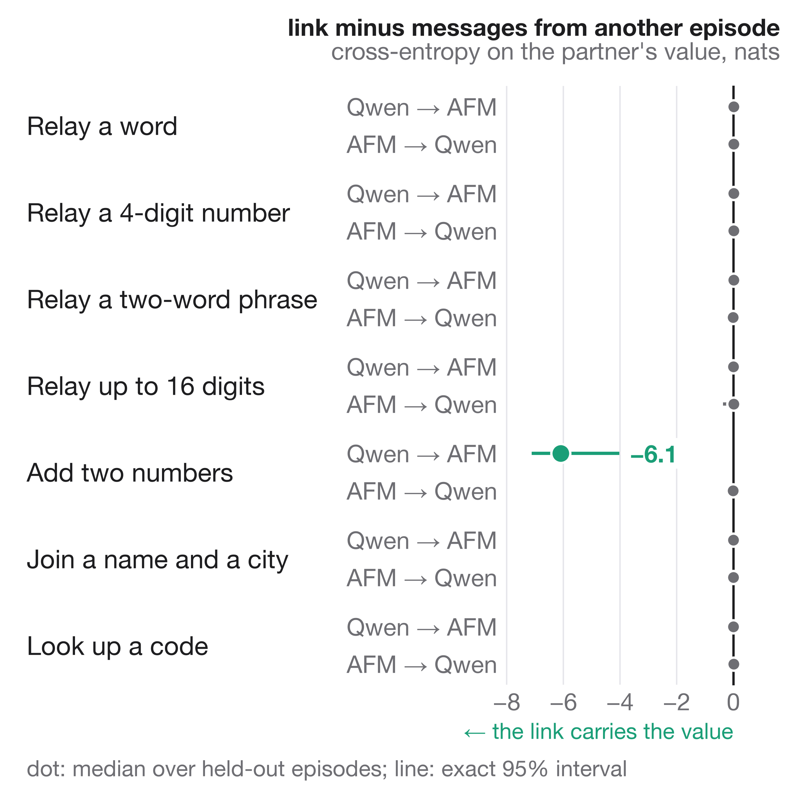

# neural-pairing

Two language models from different families, Quill (Qwen3-4B) and Ember (AFM-4.5B), are trained together with a learned
channel between their forward passes, so that each can pass information to the other without text. Both models have 36
blocks and a 2560-wide residual stream.

**Result so far: negative.** In both designs tried, the receiving model does not learn to read the learned part of the
channel. After 200 training steps, held-out cross-entropy on the partner's value is no lower with the real messages than
with messages from another episode, in every game and direction, with one exception (adding two numbers, Qwen to AFM).
That exception comes from the part of a message that is the sender's next-token distribution re-embedded as text, not
from the learned part.



## Setup


**Games.** Both models write a reply at the same time, one token per tick, and neither sees the other's text
(duplex). Each game puts a value in one model's prompt that the other model must write:

- relay a word, a 4-digit number, a two-word phrase, or up to 16 digits;
- add two numbers, one in each prompt;
- join a name and a city, one in each prompt;
- look up a code in the partner's table.

Non-payload games are also in the training mix: steering the partner to a concept, and saying who you are. There are
also dialogue games and competitive games (resist, impersonate, bluff). The prompts and teacher-forced replies come from
`prep.py`; the game definitions are in `games.py`.

**Training.** LoRA (rank 32) on both models plus both halves of the link. Training uses teacher-forced coupled forward
passes with 2 or 3 Gauss-Seidel rounds (`link.Pair.coupled`), which are exact for every chain of up to 2R hops between
the models. For the first 40% of the schedule every gate is open and sending is free.

**Exactness checks** (`tests/`). On tiny random models of both architectures:

| Check | Max difference |
|---|---|
| Coupled training forward vs step-by-step generation | 5e-7 to 1.9e-6 |
| Gradients with vs without gradient checkpointing | 0 |
| Two-rank data parallel vs single process | < 1.7e-6 |

## Design 1: additive residual write

The send head reads the sender's residual after block 24 and writes a 256-number message and a gate. The receive adapter
maps the gated message into the partner's residual after block 11, at the partner's next token. Variants tried:
zero-initialized receive adapter, random init, and an "inbox" where messages stay in the stream.

**Result.** Payload accuracy was at most 1/32 in every relay, merge and lookup game at step 200, and the gates closed
once sending had a cost. On training batches, payload cross-entropy with the link matched the link-cut value to within
0.03 nats per payload token in every game but lookup, which has only 4 payload tokens per batch and differed by up to
0.28 (for example, adding two numbers: 1.41 vs 1.41).

**The fault is on the receiving side.** A ridge classifier on the messages, fit on 384 episodes and scored on 128 others
(`decode.py`), decodes the sender's own number in the two-number game 128/128 times (exact 95% interval 97–100%; chance
2%). It does so from the trained send heads and also from an untrained one. So the value is in the message from the
start, and the receiver never uses it. The first digit of relay-digits is not decodable from the sender's first four
messages (3–13%; chance 10%). The sender's reply answers an unrelated question and never mentions the digits.

## Design 2: soft-token slot (`train.py --soft`)

Each partner message becomes an extra input position (a slot) placed just before the receiver's token it reaches. Later
receiver tokens attend to the slot. The slot vector is

    sum_v p(v) E_recv[v]  +  (1 - sum_v p(v)) null  +  recv(message) * size

The terms are:

- `p` is the sender's next-token distribution at that tick (detached).
- The sum runs over tokens whose decoded strings match exactly between the two vocabularies: 108,580 of Qwen's 151,669
  and 108,575 of AFM's 128,005.
- `null` is a learned vector.
- `recv` is the receive adapter, zero at initialization.
- A closed gate gives the null slot.
- Cutting the link masks the slots and renumbers positions, so the receiver reads exactly its own text.

**Why a shuffle control.** Link vs cut is not an information test here. Removing the slots changes the receiver's
input, and at step 0, before any training, the median of link minus cut already ranged from −16 to +5 nats across
game × direction slices. The control is
shuffled messages: each episode gets the messages, including the slot text, of another episode of the same game. The
receiver's input is perturbed as much as with the real link, but the information is removed (`payload_ctl.py`).

**Runs.** One A100, 200 steps of the 1000-step schedule, every gate open, batch size 16, two arms:

- **default**: link learning rate 1e-3, size 0.3.
- **large**: link learning rate 3e-3, size 1.0.

Evaluation uses 140 fixed held-out episodes: test split, seed 4242, 20 per payload game. Each episode yields one
difference d = link − shuffle in mean cross-entropy over the payload tokens; the two merge games average their two
receivers. The intervals are exact distribution-free 95% intervals for the median (binomial order statistics). The p
values are exact sign tests.

| Arm | Slice | Median link − shuffle (nats) | 95% interval | Link lower | Sign test p |
|---|---|---|---|---|---|
| default | all 140 episodes | −0.0035 | [−0.0091, +0.0049] | 74/140 | 0.55 |
| large | all 140 episodes | −0.0021 | [−0.0063, +0.0005] | 78/140 | 0.20 |
| default | add two numbers, Qwen → AFM | −6.09 | [−7.11, −4.03] | 19/20 | 4e-5 |
| default | add two numbers, AFM → Qwen | −0.011 | [−0.031, +0.001] | 13/20 | 0.26 |
| large | add two numbers, Qwen → AFM | −0.010 | [−0.033, +0.028] | 11/20 | 0.82 |

Every other game × direction slice in both arms has a median within ±0.02 nats and an interval that contains 0; the
per-slice values are in `results/probe.json` and the figure above.

**The one positive slice is soft text.** In the two-number game each model writes its own number, so the sender's
next-token distribution puts its mass on that number's tokens.

- Qwen writes "37" as `3`, `7`. Both tokens exist in AFM's vocabulary, so AFM receives Qwen's digits as soft text.
- AFM writes "37" as the single token `37`, which has no exact match in Qwen's vocabulary. Its mass goes to the null
  vector, so Qwen receives nothing.

In the relay games the sender's reply answers an unrelated question and never contains the value, so only the learned
part could carry the value, and it carries nothing.

**The large arm loses even this.** At size 1.0 with the faster link learning rate, the learned part grew to 11–14×
the RMS of the input embeddings and swamped the text part.

## Baselines (QA)

These are for the planned benchmark comparison: ARC-Challenge and MMLU, 1500 steps each, validation accuracy on 128
questions, exact 95% intervals.

| Configuration | Accuracy | 95% interval |
|---|---|---|
| Qwen alone, fine-tuned | 86.7% | [79.6, 92.1] |
| AFM alone, fine-tuned | 84.4% | [76.9, 90.2] |
| A text pair answering in turn | 85.9% | [78.7, 91.4] |

The linked pair was not benchmarked, because the link carries nothing it could use.

## Running

```
pip install torch transformers peft datasets safetensors scipy matplotlib
cd pairing
python prep.py --out OUT                          # prompts and teacher-forced replies -> OUT/replies.json
python build_bench.py                             # ARC + MMLU splits -> data/bench.json (only for --qa/--solo/--text_pair)
python train.py --replies OUT/replies.json --out OUT/run --soft --payload_eval 140
python payload_ctl.py --run OUT/run/step_N --replies OUT/replies.json --out OUT/ctl.json
python decode.py --replies OUT/replies.json --run OUT/run/step_N     # is the payload in the messages?
cd .. && python tests/test_link.py && python tests/test_ddp.py --replies OUT/replies.json --soft
python figures/make_figures.py
```

`evaluate.py` measures game accuracy on held-out episodes with the link cut, shuffled or randomized. `bench_eval.py` runs
the QA benchmark arms. `rl.py` runs self-directed play, and `demo.py` writes transcripts.

---

Claude Opus 5.5
